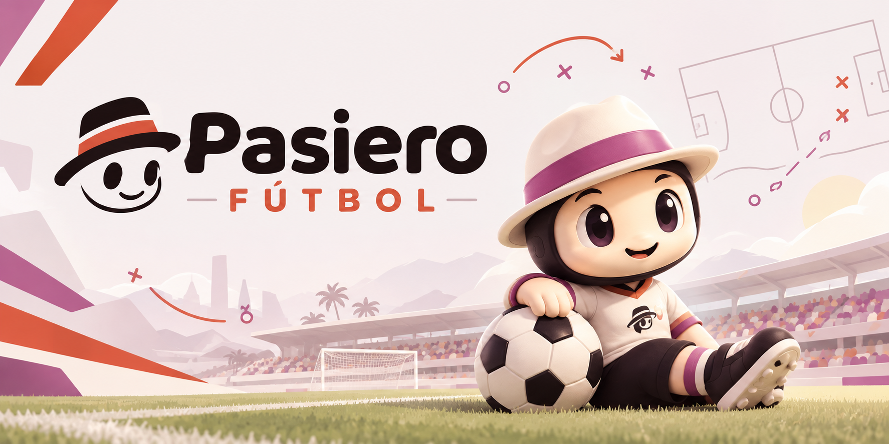

# Pasiero Futbol



**Match intelligence for the Premier League.**

> Explainable match intelligence from synthetic football events, built for the hackathon in [CHALLENGE.md](CHALLENGE.md) (criterion by criterion, with where to see each: [SUBMISSION.md](SUBMISSION.md)). A club's **match device** measures every match every 5 minutes: both teams' data (possession, passes, **pass quality and ball speed**, PPDA, field tilt, final-third entries by channel, shots and xG, regains), their **shape** in and out of possession, the **set pieces** (every delivery into the box: the routine, who won the first contact, the xG that came of it) and **every player's running**. It finds the **technical plays** and checks everything against the staff's **game plan**: when a target is off the plan for 15 minutes, a **deviation** says what was measured, against what, and the plan's own instruction for it. A **team of AI agents** on **Microsoft Agent Framework** and **Azure OpenAI** answers the staff's questions from those numbers and tells each match's story, for a fan, a coach, an analyst or a broadcast's captions, in any language, following one player if asked. The **analysis room**, **Grafana**, **n8n**'s reports to the staff's phones and the Video tab show it alongside the match. It runs offline too: without Azure, a local model on Ollama answers. The demo's club is Brighton & Hove Albion; every match is synthetic.

| | |
|---|---|
| Built for | The people around a Premier League match: the club's analysts and bench (the calls, the plan), the coaching staff (the reports), broadcast (captions) and fans (the story in their language). The demo's club is Brighton & Hove Albion, 2026-27 |
| Microsoft and Azure | **Microsoft Agent Framework** 1.23: the team of agents (`ai/agent/team.py`: an orchestrator, an analyst, a coach and a narrator, agents as tools, function middleware). **Azure OpenAI**: the team's model, by Microsoft Entra ID (the VM's managed identity) or a key. **Azure Virtual Machines, Key Vault, managed identities**: the whole stack hosted privately for the judges, behind a password login, from Terraform, its secrets in Key Vault, deployed by GitHub Actions with OIDC ([deploy/azure](deploy/azure/README.md)). **Azure Machine Learning**: our own shirt-number model, trained on synthetic players and exported to ONNX ([ai/vision/shirts](ai/vision/shirts/README.md)) |
| Data | Synthetic only: a match engine plays the season 5 times a second, and every document it posts says `"synthetic": true` (*Demo data* on every screen) |
| Layers | `iot`, `ai`, `extras` |
| Services | iot: ingest (+ analysis room, plan editor, season page, reports) · Mosquitto · InfluxDB · Grafana (+ demo club device) · ai: agent (+ the team) · Ollama · n8n · Mailpit · vision (profile, on demand) · extras: go2rtc |
| Theme | `theme/`, the one in use of [`themes/`](#themes) (`iot/scripts/theme.py use <id>`): `pasiero-futbol`, Pasiero Futbol's look and feel from [its banner](pasiero-futbol-banner.png): warm ink, orange `#D9553A` for the accent, magenta `#B0517B` for the score, an orange-into-magenta bar along every header, and the smiling face in the hat as the logo; dark first, Fredoka + Nunito + IBM Plex Mono. The Premier League theme it replaced is kept as `pl-match-intelligence` |
| League | `iot/ingest/analysis/league.json`: the 2026-27 Premier League's 20 clubs (codes, grounds, kit colours, crests in `analysis/crests/`); `squads.json`: made-up names for every shirt number. The simulator, the analysis room, the reports, the synthetic cameras and the ingest service read them |
| Built on | p4n4's `mqtt-influx-grafana-ollama-go2rtc` template 0.4.0 |

```
  extras/
  extras/clips/<camera>.mp4 (real recordings) ──► clips :1985 (nginx) ──MP4──► p4n4-dashboard Video tab, with the vision overlay
                                             └──► video :1984 (go2rtc) ──MJPEG──► analysis room (or a real camera's URL)

  club match device (tracking + analytics) ═══HTTPS, X-Site-Token═══╗   team contract 0.1: fixtures, windows
  simulator (profile "demo": engine.py + analytics.py) ─────────────╢   (running, set pieces, pass quality),
  clips.py (vision on recorded footage) ────────────────────────────╢   plays, heartbeat
                                                                    ▼
  iot/                                                       ingest :8090 ──┬──► iot/data/ingest/ingest.db (matches, windows, plays,
     staff: analysis room, plan editor, season, reports ──► :8090/analysis/ │      game plans, deviations, calls)
     p4n4-dashboard Feed tab ──► p4n4-api ──────────────────────────────────┤──► influxdb ──► grafana :3000 (Match analysis)
                                                                            └──► mqtt  brighton/<site>/window|play|deviation|…
  ai/  p4n4-dashboard Agent tab ──► agent :11434 ──┬──► Azure OpenAI: the team (Microsoft Agent Framework)
       analysis room's Match story ──► ingest ──►  │      orchestrator ──► analyst · coach · narrator ──► ingest agent API
       n8n's reports ─────────────────────────────►├──► ollama (gemma4:e2b): the offline fallback
                                                   └──► ingest agent API (fixed numbers and sentences)
       ingest ──deviation, half time, full time──► n8n :5678 ──► email (Mailpit :8025 in the demo) · Slack · Telegram
       vision (matchvision, on demand) ──► extras/clips/analysis/ ──► clips.py post, the Video tab's overlay (vision.json)
```

## The idea

Football stories don't start and end with the scoreline. A club's analysts already have the numbers; what they don't have is **the game plan checked as it's played**, and a way to turn the same numbers into the story each audience needs. This does both, from one pipeline:

- **Ingest:** a match device (here, a match engine) sends five minutes of a match at a time, and every play as it's found, through a versioned contract.
- **Interpret:** the press, the shape, set pieces, pass quality (length, accuracy, a difficulty rating), ball and shot speed, every player's running and his milestones (over 30 km/h, 5 and 10 km), checked every 5 minutes against the staff's plan.
- **Explain:** a deviation says what slipped, from when, against what the plan asked, and the plan's own instruction for it; the narrator agent explains why a moment mattered (control against chaos, the press, the plan holding or slipping, a player's legs going).
- **Render:** the analysis room on the booth's screen, Grafana, the Video tab's overlay, broadcast captions, MQTT for anything else that draws over a match.
- **Personalize:** the analyst gets the calls and the numbers, the coach the options, a fan the story in plain words, in their language, following their favourite player; the half-time report is on the coaches' phones before they reach the dressing room.

Nothing here judges a player or a coach. It measures, compares with what the staff asked for, and leaves every call to the staff. The device knows players by shirt number; the demo season gives each one a made-up name (below).

A presenter's script for the demo video: [DEMO.md](DEMO.md).

## Quick start

```bash
cd pasiero-futbol   # this repository (github.com/jraleman/pasiero-futbol)
for layer in iot ai extras; do cp $layer/.env.example $layer/.env; done   # change passwords and tokens
# optional: the team of agents on Azure OpenAI, in ai/.env (without it, the local model answers)
#   AZURE_OPENAI_ENDPOINT=https://<resource>.openai.azure.com/  AZURE_OPENAI_DEPLOYMENT=<a chat model, e.g. gpt-4.1-mini>
#   AZURE_OPENAI_API_KEY=<a key, or empty for Microsoft Entra ID>
p4n4 up                     # iot, then ai, then extras
python3 extras/scripts/clips.py post # optional: our own footage's matches (needs its analyses, see Video)
```

**On Azure,** the same stack on a VM behind HTTPS, with Azure OpenAI by managed identity and the secrets in Key Vault: `cd deploy/azure && terraform apply` ([deploy/azure/README.md](deploy/azure/README.md)).

**On an NVIDIA Jetson** (an Orin Nano as the club's match device, Ollama on its GPU): `deploy/jetson/up.sh <user>@<host>` from this machine copies the project, the loops and their analyses, starts the three layers and p4n4-api there; the header of [up.sh](deploy/jetson/up.sh) says how to reach the dashboard. The board's 8 GB are shared by CPU and GPU, so stop whatever else runs on it first.

Without the CLI, start the layers in that order: `(cd iot && docker compose up -d) && (cd ai && docker compose up -d) && (cd extras && docker compose up -d)`. Like every p4n4 project, this one uses the fixed `p4n4-*` container names and ports, so stop any other p4n4 project on the host first. The simulator plays and measures the past matches first, about 10 s each, so the season fills in over the first minute or two.

| Open | For | Login |
|---|---|---|
| <http://localhost:8090/analysis/> | The **analysis room** | Your name, and the staff token (`INGEST_READ_TOKEN`, `demo-read-token`) |
| <http://localhost:8090/analysis/plan.html> | The **plan editor** | The same |
| <http://localhost:8090/analysis/season.html> | The **season**: set pieces for and against, the squad's running | The same |
| <http://localhost:3000> | Grafana: **Match analysis** is the home page | `admin` / `adminpassword` |
| <http://localhost:1984> | go2rtc: the cameras | none |
| <http://localhost:8025> | Mailpit: every email n8n sends (the bench's, the staff's and the coaches' inboxes) | none |
| <http://localhost:5678> | n8n: the two workflows | `admin@example.com` / `adminpassword` |
| <http://localhost:11434> | The agent (Ollama's API, for the Agent tab): the team on Azure OpenAI when it's set, else the local model (pulled on first start, about 4.6 GB) | none |

### What the demo shows

**The season.** The `demo` profile is Brighton's match device (`SITE_ID=brighton`). On start it posts the club's **default plan**, then `SIMULATOR_HISTORY` (8) past matches: Saturdays at 15:00, at the Amex and away in turn, against the Premier League's 2026-27 clubs. Three in four have a plan of their own, made for the opponent, with a target on the channel to attack. Both benches make their changes from the hour; in about two matches in five one of ours tires (and comes off, more often than not). Most have a stretch or two where something slipped, and every deviation already has the analyst's call: flagged with a note ("Back four not stepping up after back passes: talk at the break", "Told the bench: sub warming up"), or set aside as expected ("Our call: a back five to see the lead out"). Then a match is always being played at the Amex, sped up `SIMULATOR_SPEED` (3) times: 44 minutes a match, half time included, then the next opponent. Each date's match keeps its id, so restarting never duplicates anything.

**The live match tells the same story every time** (the minutes are the match's; the details vary a little with the opponent):

| Minute | What happens | What the analysis room shows |
|---|---|---|
| 1'–25' | On plan: 3-2-5 in possession, 4-4-2 out of it, a high line, a hard press | ✓ across the scorecard |
| 19' | **#10 wins it high, #9 scores** | A high regain and a goal "after a high regain" · 1-0 |
| 25'–45' | The line drops and the press fades | Team length off plan by 35', line height by 40', in most matches PPDA, possession or the counter-press too |
| 41' | **Their counter plays through the press** | A goal "on the counter" · 1-1 |
| Half time | | The half-time report reaches the staff a minute in: the deviations, the analyst's calls, the set pieces, who's running less |
| 46'–60' | Back on plan after the talk | Each first-half deviation "back on plan" by 50'–60' |
| 58' | **They change to a back three in possession** | A formation change (theirs): 4-2-3-1 to 3-4-3 |
| 63' | **The near-post flick: #7's inswinger, #5 heads it in** | A set piece, "near-post flick", first contact ours, a goal "from a set piece" · 2-1 |
| 50'–70' | **#7's legs go** | His metres a minute fall away (the Running panel's bars); the running drop, a key target, is off plan at 65'–70': "#7 running 29% less than his first 30'" (about 30%, with the opponent). The bench's phones get it |
| 72' | **#7 off, #19 on** | The drop is back on plan by 80' |
| 70'–90' | A 5-4-1 to see it out; the wide players drift inside | A formation change (ours), then deviations at 80'–85': the shape, the width, the left channel. The analyst may well call them expected |
| Full time | | The match report reaches the coaches five minutes later |

`python3 iot/scripts/simulate.py --schedule` (on the host) prints when this and the next live match reach each of those moments, in local time.

Everything the simulator posts is marked `"synthetic": true` and says *Demo data* on every screen. Clubs, crests and grounds are the league's (`league.json`); players are shirt numbers by role (1 the keeper, 2 to 5 the back four, 6 the holding midfielder, 9 the striker…), substitutes 14 and up. Each number has a **made-up name** (`iot/ingest/analysis/squads.json`, written by `iot/scripts/squads.py`, seeded per club so it's the same every run): the analysis room, the sentences, the reports and the assistant say "#7 Tomas Calloway". No real player is named.

**Before a meeting,** start from clean data: `iot/scripts/reset_demo.sh` moves the ingest database to `iot/data/ingest/backup-<time>/`, deletes the matches from InfluxDB (Grafana's season too), restarts the ingest service and the simulator, and posts the recorded footage's matches again when their analyses are on the disk.

## The game plan

A plan is a title, the formation in and out of possession, up to 16 targets, instructions and opponent notes. Write it in the **plan editor** (`plan.html`) for one match, or as the **club default**, which every match without its own uses (marked *Club default* everywhere). Saved during a match, a plan applies from the next 5 minutes. A scouting match never has one.

Each target is a metric, `≥` or `≤`, a value, a tolerance and whether it's a key instruction (★). Over any stretch of the match a target is **on plan** (met), **drifting** (within the tolerance), **off plan** or **no data yet** (e.g. fewer than four set pieces). Statuses are ruled at the precision they're shown. The analysis room shows each target over the match so far, each half, the last 15 minutes, and every 5-minute window as a sparkline.

| Metric | What it is | Default op · tolerance |
|---|---|---|
| Possession | Our share of the time the ball was in play | ≥ · 4 |
| Pass completion | Completed passes over passes | ≥ · 3 |
| Press intensity (PPDA) | Their passes in their own 60% per defensive action of ours there; lower is a harder press | ≤ · 2 |
| Defensive line height | Out of possession, our four deepest outfield players' average distance from our goal line | ≥ · 3 m |
| Width in possession | Between our widest outfield players | ≥ · 3 m |
| Team length out of possession | Deepest to highest outfield player; lower is more compact | ≤ · 3 m |
| Field tilt | Our share of the completed passes into or inside either final third | ≥ · 5 |
| Counter-press regains | Of the balls we lost, the share won back within 5 s | ≥ · 5 |
| High regains per 90 | Won within 40 m of their goal | ≥ · 1.5 |
| Final-third entries down the left / middle / right | The share of our passes and carries into the final third through that channel | ≥ · 6 |
| Goal kicks played short | Under 32 m | ≥ · 10 |
| Shots conceded per 90, our xG per 90, xG conceded per 90 | | ≤ / ≥ / ≤ |
| **Set pieces: first contact won** | Of our deliveries into the box (corners, free kicks within 35 m, long throws), the share where we won the first contact | ≥ · 10 |
| **Defending set pieces: first contact** | Of their deliveries into our box, the share where we won it (or nobody did) | ≥ · 10 |
| **Set-piece xG per 90**, **conceded per 90** | The xG of the shots in the 8 s after a set piece | ≥ / ≤ · 0.15 |
| **High-speed running per 90**, **sprints per 90** | The team's running over 5.5 m/s (19.8 km/h), its efforts over 7 m/s (25.2 km/h) | ≥ · 400 m / 15 |
| **Running drop (any player)** | The biggest drop in ground covered per minute among our outfield players: each one's last 15' against his own first 30'. A player on for less than two thirds of the stretch, or under 20 of the first 30', doesn't count | ≤ · 3 |
| Shape in / out of possession | The formation the device reads, against the plan's | the same formation |

**Deviations.** After every finished window, the ingest service rules the last three (15 minutes) on each target. Off plan, and none open for it: a deviation opens, high priority for a key target. Back on plan (not just drifting): it closes, "back on plan at 60'". It's a reading, not a verdict: the analyst **flags it for the bench** (with a note for the talk or the report), sets it aside as **expected** ("protecting the lead"), or reopens it. A device re-sending a window never touches a call. A running drop names its players: "#7 running 29% less than his first 30'" (91 m a minute against 129), and the next ones.

The club's default plan, as the demo has it: build in a 3-2-5, defend in a 4-4-2. PPDA ≤ 8 (★, tolerance 3), line height ≥ 38 m (★), team length ≤ 35 m, width ≥ 48 m, possession ≥ 45%, counter-press ≥ 24% (tolerance 8), set pieces' first contact ≥ 45% (tolerance 10), defending set pieces ≥ 60%, running drop ≤ 18% (★). Opponent plans add a channel (≥ 32% of entries down the side their weak full-back is on). The targets were set from what the engine's on-plan play measures over 15-minute stretches (so a team playing the plan stays on it) and what its slips measure: in the engine, as in a match, a player's metres a minute over 15 minutes vary by about 5% on their own and fall a few per cent late on, so 18% is a real drop. High-speed running over 15 minutes varies far more (about 40%), so it isn't a live target: it's in the tables, per 90, and for the season.

## Set pieces

The device counts a **delivery** for every corner, every free kick within 35 m of goal and every long throw (a throw-in in the final third landing in the box, 15 m or more): where it was taken from, where it went (near post, far post, six-yard box, penalty spot, edge of the box, short), its swing (inswinging, outswinging, driven, a long throw, short, a shot at goal), the **routine** (the club's own name for it, as the staff gave the device their playbook), who won the **first contact** (the first touch within 4 s: ours, theirs or nobody's), and the shots and xG before the ball was lost or the next restart. Ours and theirs alike, so the same numbers say how we attack them and how we defend them.

- **In the analysis room:** the match's deliveries on the attacking half (a dot where each went, coloured by what came of it, hollow when the first contact was lost), each routine's results, every delivery (click one for its 2D replay).
- **On the season page:** our routines over the season (deliveries, first contacts, shots, xG, goals), what we face (by where it's aimed and by opponent), both maps, and every match's set pieces for and against. Choose an opponent and it's that club's set pieces against us: scouting for the next match.
- **In the plan:** first contacts, attacking and defending, and set-piece xG as targets; four deliveries before a stretch says anything.

The demo's playbook: the **near-post flick** (#5 attacks the near post, the inswinger from #7 or #11; the 63' goal), the **six-yard screen** (#9 on the keeper), the **back post** (#4) and the **short corner** (to #8); **long throws** from #2 into the near post (a habit of the engine's, not Brighton's); wide free kicks to #4 at the penalty spot. Opponents have routines of their own; the device names only ours.

## Running

Every window carries each player's running, from one position a second (so the tracker's jitter doesn't add up): seconds on the pitch, distance, **high-speed running** (over 5.5 m/s, 19.8 km/h), **sprints** (efforts over 7 m/s, 25.2 km/h) and top speed. A step faster than 10 m/s is the tracker losing a player, and counts for nothing. Goalkeepers are named per window, so they stay out of the team's shape and the running drop.

- **In the analysis room:** every player (ours or theirs): minutes, km, metres a minute, high-speed metres, sprints, top km/h, the metres a minute in every 5 minutes as bars (the last 15' darker), and for ours the drop over the last 15' against his first 30', ruled against the plan. **Milestones** tag a player the first time he passes 30 km/h, and when he reaches 5 and 10 km, on the 5 minutes he did it in (⚡ 31 km/h, 10 km; `SPEED_TAG_KMH`, `DISTANCE_TAGS_KM` in `store.py`).
- **On the season page:** the squad per 90 (km, high-speed metres, sprints, top speed), and every match's high-speed running, ours against theirs.
- **In Grafana:** both teams' high-speed running every 5 minutes, and our players' table.

The demo's engine moves its players as people move: a small gap closed at a jog, a bigger one run, a long one sprinted, speeding up and slowing down at most 3 m/s², with the team changing shape over a couple of seconds when the ball changes hands, forwards running in behind and full-backs overlapping, recovery sprints when far out of place, and legs that tire a little through the second half. Outfield players who play the whole match cover 8.5–12.5 km, 550–1,450 m of it at high speed, with 20–65 sprints (the middle 90% of them, over five matches); for set pieces the box runners and their markers sprint to their spots. Its substitutes come on from the hour.

## The analysis room

`:8090/analysis/` (sign in with your name and the staff token), for the booth's screen or a laptop on the bench:

- **The header:** the theme's mark and name, the score with both crests and kit colours, the minute, *Demo data* (or *Scouting footage* for a match from recorded footage), a picker for every match ("10-17 v FUL W 2-1 · 3 to call"), and links to the plan, the half-time report, the match report and the season.
- **Game plan:** the plan's title (*Club default* when inherited), the formations planned against read, the share of targets on plan, and the scorecard: each target, ★ if key, what it is, the plan, the match so far and the last 15' with their status (✓ ~ ✕ and a word, never colour alone), and its value every 5 minutes against the plan's line.
- **Shape:** average positions by shirt number, attacking right, for either team, in or out of possession, over the match, a half or the last 15', with the plan's formation drawn over them; out of possession the defensive line, in possession the pass network.
- **Match timeline:** xG every 5 minutes, ours up and theirs down; the key plays on their minute; each deviation as a bar.
- **Team data:** both teams over the chosen part of the match.
- **Set pieces** and **Running**, above.
- **Match story:** the narrator agent tells the match so far, the first half or the whole match, for **a fan** (plain words, what a number means the first time), **the coaching staff** (how the plan held, the readings), **an analyst** (dense, the numbers behind each phase) or as **broadcast captions** (3 to 5 lines under 80 characters for a lower third), in any of 14 languages (Arabic right to left), and can **follow one of our players** through it (his part in the moments, his running). It says which model wrote it. Below, [Recaps](#recaps).
- **Deviations:** to call, or all; each opens with what was measured, what to check, a note, and **Flag for the bench** (F), **Expected** (E), **Reopen** (R). J/K move through them.
- **Technical plays:** key plays or all, by type and team; each opens in the **play viewer**: the 2D replay (0.25×–1×, frame by frame), the players it names ringed, the keyframe (a drawing, or the real frame for a play on footage) or the live camera, what the device measured and how the play was found (the tracking, the video models, or a person's label).

**The reports.** `report.html?part=half|full#<site>/<match>`: A4, printable. Page one: the score, the plan's targets per half, the deviations for the talk or the debrief, signature lines for the analyst and the head coach. Page two: the shapes, the team data, the instructions and opponent notes, the key plays with their keyframes. Page three: the set pieces (both sides, our routines, every delivery) and every player's running with his drop.

## Notifications (n8n)

The ingest service posts three events to n8n (`NOTIFY_URL`, `http://n8n:5678/webhook/brighton`), with `NOTIFY_TOKEN`: a deviation opening while the match is on (`/deviation`, under 30 minutes old), half time (`/half-time`) and full time (`/full-time`).

| Workflow | Does |
|---|---|
| **Brighton · off the plan** | Each deviation whose priority is in `NOTIFY_PRIORITY` (default `high`: the key instructions, the running drop among them) goes to `STAFF_EMAIL_TO`, and to Slack and Telegram when set (the bench's phones): the minute, what was measured against the plan, the match so far, what to check, and a button that opens it in the analysis room |
| **Brighton · reports** | `HALFTIME_DELAY` (60) seconds after the half-time whistle, the half-time report to `STAFF_EMAIL_TO`; `REPORT_DELAY` (300) after full time, the match report to `REPORT_EMAIL_TO`: the plan's targets, the deviations with the calls and notes, both teams' numbers (set pieces, high-speed running and sprints among them), who is running 10% or more under his first 30', the key plays, the **narrator agent's story** of the half or the match first (`RECAP_LANGUAGE`, `RECAP_AUDIENCE`; the report goes out without it if the agent can't write one), a button to the printable report, and a CSV of every target in every 5 minutes. `GET /webhook/brighton/report?match_id=…&part=half` sends one now |

Generated by `ai/config/n8n/build.py` from the JavaScript in `ai/config/n8n/src/` (edit those and rebuild, then `N8N_REIMPORT_WORKFLOWS=true` for one start). In the demo, Mailpit catches them all at <http://localhost:8025>.

## Data contract (club device ↔ web 0.1)

The club's device posts with its token (`X-Site-Token`); `iot/ingest/contract.py` has every rule. One device and one `site_id` (`brighton`) for every match, home and away: the device travels with the team, or reads the league's tracking feed.

| Schema | Endpoint | What |
|---|---|---|
| `p4n4.team.fixture/0.1` | `POST /api/v1/fixtures` | The match: `match_id`, `competition`, `matchday`, `home`/`away` `{code, name}`, **`team`** (which side is ours), `venue`, `kickoff`, `status`, `period`, `score` (the referee's, never a model's); `"scouting": true` for footage filmed to scout (neither side ours: no plan, not in the season) |
| `p4n4.team.window/0.1` | `POST /api/v1/windows` | Five minutes of a period, per team: the counts (possession, passes, PPDA's two halves, entries by channel, box entries, shots, xG, goals, turnovers, regains, corners, free kicks, goal kicks, **set pieces, their shots, xG and first contacts won**, **distance, high-speed metres, sprints**; optionally **pass quality and ball speed**: `passes_rated`, `pass_distance_m`, `pass_difficulty`, `passes_hard`, `passes_hard_completed`, `passes_timed`, `pass_speed_ms`, `ball_speed_max_ms`, `shot_speed_max_ms`), the shape in and out of possession, the pass network, **`physical`** (`[number, seconds, distance m, high-speed m, sprints, top speed m/s]` per player) and `keepers`. The window being played is `"final": false` |
| `p4n4.team.play/0.1` | `POST /api/v1/plays` | One play: `type` (goal, shot, save, set_piece, high_regain, counter_attack, build_up, press_broken, foul, formation_change), `team`, `period`, `match_time_s`, the players by shirt number and role, `details` per type (a set piece's kind, routine, swing, delivery, side, first contact, xG, outcome and end point), the key moment (`snapshot`) and the seconds around it (`track`), `evidence`, and **`source`**: `tracking`, `video` (the vision models) or `label` (a person's) |
| `p4n4.team.heartbeat/0.1` | `POST /api/v1/heartbeat` | The device's health: temperatures, tracking FPS, players tracked, ball visibility, latency |
| (a JPEG or PNG) | `PUT /api/v1/evidence/<play_id>` | A play's keyframe, up to 2 MB: the camera's frame, or the demo's drawing |

Pitch coordinates are metres on 105 × 68, x from the left goal line as the tactical camera sees it, y from the far touchline; a window's averages are in each team's own frame (attacking right). Players are shirt numbers, never names: the ingest service adds the demo season's made-up names (`squads.json`) on synthetic matches only. It also adds what is rule rather than measurement: whether a play is key (and every play from footage is), the plan's statuses, the deviations, and the sentences.

### Endpoints

| Endpoint | |
|---|---|
| `GET /api/v1/feed`, `POST /api/v1/feed/<site>:<id>/action`, `GET /api/v1/feed/<site>:<id>/image` | The feed contract: deviations (actions `confirm`, `dismiss`, `reopen`) and key plays (with their keyframe) |
| `GET /api/v1/analysis/matches`, `/analysis/match?match_id=`, `/analysis/play?play_id=` | The analysis room: matches; one match in full (stats, timeline, adherence, deviations, plays, shapes, **physical**, **set pieces**); one play with its replay |
| `GET /api/v1/analysis/set_pieces?period=&opponent=`, `/analysis/physical?period=` | The season page: set pieces for and against, the squad's running per 90 |
| `GET /api/v1/analysis/recap?match_id=&part=&audience=&language=&focus=` | The analysis room's Match story: forwarded to the agent's `POST /api/recap` (`AGENT_URL`), outside the store's lock (the agent reads the match back from here) |
| `GET /api/v1/agent/match` · `/plan` · `/formation` · `/plays` · `/play` · `/set_pieces` · `/physical` · `/season` · `/nodes` | The agent API |
| `PUT /api/v1/plans/<match_id|default>`, `GET`, `DELETE`, `GET /api/v1/plans/catalog` | The plans (the staff's token) |

InfluxDB gets `team_window` (with set pieces and running), `player_run` (each player's running per window), `plan_check`, `team_play`, `plan_deviation`, `deviation_review`, `team_fixture`, `team_node` and the heartbeat as `sensor_data`; MQTT gets `brighton/<site>/window` (without positions and pass network), `play/<type>` (without the track), `deviation`, `review`, `plan`, `fixture`, `heartbeat`. `iot/ingest/sinks.py` documents both.

## How the device measures (analytics.py)

`iot/scripts/analytics.py` is the device's measuring, standard library only. It takes tracking frames (every player and the ball, 5 times a second here) and on-ball events (passes with their receiver, carries, shots, tackles, interceptions, clearances, fouls with who was fouled, restarts with their routine when the device knows it), and gives windows and plays.

- **Possession** goes to the team of the last on-ball event.
- **Shape** is read in settled phases (from 5 s after the ball changes hands): the four deepest outfield players' average x is the line height; the outfield spread gives width and length; the ten outfield players who were there most give the average positions; the formation is the closest of ten templates (an optimal assignment, the Hungarian method; depth counts 1.6 times width).
- **xG** is a simple model on the shot's place: the angle the goal mouth makes and the distance (about 0.33 from the spot, 0.05 from 25 m, 0.7 from 6 m, a header 60% of that).
- **Pass quality:** each pass with an end point gets a **difficulty** from 0 to 1: its length (up to 40 m counts), how far forward it goes (up to 30 m), the pressure where it's received (the nearest opponent there when it arrives, within 10 m) and whether it reaches the final third. A window sums the passes' length and difficulty, and counts the **hard passes** (0.6 and over, about one in five) and how many were completed. The analysis room's Team data shows the average length and difficulty (0–100) and the hard passes completed.
- **Ball and shot speed:** a pass's or shot's speed is the ball tracker's reading on the event when the device sends one (`speed_ms`), else the fastest step of the ball's track in the 0.8 s after it's struck (steps over 45 m/s are the tracker losing the ball). A window carries the passes' average speed, the fastest ball and the fastest shot; every goal and shot play says how hard it was struck (`speed_kmh`, in its sentence too). The engine flies every pass at one pace (its story is timed to it), so its events carry a modelled reading: a longer ball struck harder, about 50 km/h over 10 m and 80 km/h over 40 m; shots about 70–130 km/h by distance, headers 40–70.
- **Set pieces** and **running**, above.

**The demo's match engine** (`engine.py`) plays a whole match from a seed, 5 times a second: every player in his formation's place around a block that follows the ball, moving as described under Running, the nearest defender closing down. Possession moves by passes, carries, tackles, interceptions and restarts; misplaced passes and tackles near the touchline go out for throw-ins, clearances and tackles near goal for corners. Each team has a style per 5 minutes (formations, line heights, lengths, widths, press, passing, directness, channels, strength in the air, long throws, its corner routines), and a story changes them and scripts the plays it wants. It isn't football, but it measures like it: about 600 passes a team at 80%, 10–25 shots, 10–20 corners, xG 1–2, PPDA 5–14. The synthetic cameras draw the same engine's frames.

## Grafana

`iot/scripts/build_dashboard.py` writes **Match analysis** (uid `match-analysis`). Edit the script, not the JSON.

- **The match:** tiles (on the plan, possession, xG for and against, PPDA, line height); xG per 5 minutes; the game plan every 5 minutes (✓ ~ ✕); line height, PPDA and width by minute; the deviations and the plays; set pieces and set-piece xG, both sides; high-speed running every 5 minutes; our players' running.
- **The season:** xG per match, the plan's share on plan, set-piece xG per match, high-speed running per match, PPDA per match, and which targets slip most.
- **The club's match device:** status, last heartbeat, temperatures, tracking and latency.

The header carries the theme's mark, name, tint and bar (`themes/<id>/theme.json`), and Grafana's favicon, menu and login logo are the mark too (`theme/grafana/`, from the theme's `assets.py`; the menu logo is a content-hashed file of `grafana-oss:12.4.3`, and the smoke test fails when an upgrade changes it). Ours is always blue and theirs aqua (validated categorical steps, always beside the club codes); the plan's statuses take the status colours with their icons; the theme's colours are identity, never data.

## Video

The Video tab shows only real recordings, the cameras `.p4n4.json` lists (`dashboard.cameras`): each a loop `extras/scripts/clips.py` cuts, `extras/clips/<id>.mp4`, which `p4n4-clips` (nginx, `:1985`) serves as a file so the dashboard plays it itself and draws the vision overlay in step (an MJPEG stream has no playback position, so no overlay is drawn over one):

| Camera | What |
|---|---|
| `tactical` | The whole pitch in view: SoccerTrack v2's panorama of M9's first goal (M9 Yellow – M9 Blue) |
| `tv` | Broadcast: the same goal, cropped to the end where it's scored |
| `soccertrack-m3`, `-m4`, `-m7` | Three more SoccerTrack v2 goals, each cropped to its goal end |

The team's own kickabout, filmed for the vision models with numbered bibs and every player's consent ([Next](#next)), replaces them once filmed. `extras/config/go2rtc/video.sh` (go2rtc, `:1984`) still serves each loop as an MJPEG stream, and a real camera's stream from `CAMERA_TACTICAL_URL` or `CAMERA_TV_URL`: to show one, point its camera in `.p4n4.json` at `/api/stream.mjpeg?src=<id>` on 1984 (no overlay). Without either, go2rtc's `pitch.py` draws the simulated match, which the tab no longer shows.

**The vision pipeline** (`ai/vision/matchvision`, run on demand in the `vision` profile, CPU) finds people and the ball on recorded footage, tells the two teams apart by their kits (colour clustering per clip, so a change of kit needs no training), tracks them, reads shirt numbers (with a vision-language model, or `--numbers-onnx`: our own model, trained on Azure Machine Learning on synthetic players, [ai/vision/shirts](ai/vision/shirts/README.md)), and finds contacts and falls as plays (`source: video`), each with its keyframe. `extras/scripts/clips.py` runs it from `extras/config/clips.json` (the sources, their credit, the match and its two kits, and the ranges each camera loops), posts the plays, and writes the Video tab's overlay (`extras/clips/vision.json`: every footage camera's boxes and play moments, `.p4n4.json` `dashboard.vision`). Until the kickabout is filmed, the manifest holds four goals from SoccerTrack v2 (CC BY 4.0: SoccerTrack v2, A. Scott, I. Uchida, K. Kuroda, Y. Kim, K. Fujii, arXiv:2508.01802; the organisers allow any footage in the demo pitch): `extras/scripts/footage.py` cuts them from the dataset's panoramas (`clips.json` `_candidates`: also SoccerNet and the DFL's, off by default; 5 GB at most), and each camera crops its panorama to the end where the goal is scored (a camera's `crop`, which the overlay follows). The panoramas defeat the pitch calibration, so the models find no goal there themselves: each source's `labels` hold the dataset's goal, posted as a labelled play (`source: label`) and flagged by the overlay.

```bash
cd ai && docker compose --profile vision build vision && cd ..        # brighton-vision:dev (CPU torch)
python3 ai/vision/fetch_models.py ai/vision/models                    # once: the three models, pickle-checked
python3 extras/scripts/clips.py fetch     # the sources → one looped clip per camera
python3 extras/scripts/clips.py analyze   # the models on each source: the plays, the teams' tracks (heavy)
python3 extras/scripts/clips.py detect    # people and ball 10 times a second on the loops
python3 extras/scripts/clips.py post      # the sources' matches and plays → the ingest service
python3 extras/scripts/clips.py overlay   # vision.json: every footage camera's boxes and moments
```

Every heavy step runs in the vision image, memory capped, without network, one at a time; run nothing else heavy beside them (stop the ai layer's Ollama). What's done is skipped; `--force` does it again. Keep port 1984 off the internet: in production these are the club's cameras, and broadcast footage is the broadcaster's. A fixed, calibrated camera at the ground is what turns the models' boxes into the tracking this project measures.

## The agents

The Assistant tab, the analysis room's Match story and the n8n reports ask one agent service (`ai/agent/`, Ollama's API on port 11434, so p4n4-api and the dashboard need no configuration). Behind it, when Azure OpenAI is set, a **team of four agents** on **Microsoft Agent Framework** (`team.py`):

| Agent | Tools | Does |
|---|---|---|
| **Pasiero** (the orchestrator, `match_intelligence`) | the three specialists, as tools (`Agent.as_tool`) | Reads the question and the view asking, calls every specialist it needs (in one turn when they don't depend on each other: "how are we doing, and what should we tell the players?" asks the analyst and the coach at once), and answers in the question's language and the viewer's register |
| **Analyst** | match summary, game plan, formation, plays, one play, set pieces, running, season, device status | The numbers, exactly as the tools give them |
| **Coach** | the briefing, running, game plan | What the staff could talk about: each target off the plan with what was measured and the plan's own instruction, the running drops, what's going well, the analyst's calls. Options, never decisions |
| **Narrator** | match summary, plays, one play, running, set pieces | The story, and why each moment mattered: control against chaos, the press, the plan holding or slipping, the moments that turned the match, a player's legs going |

- **Every number comes from the ingest service.** The specialists' tools are `local_tools.py`'s ten, wrapped as the framework's `FunctionTool`s with their own JSON schemas: they call the ingest service's agent API, so the agents pick a match, a target, a team or a play, and never count. A match can be named by its opponent ("how did we do against Chelsea?"); words a staff uses map to the ids ("corners" are set pieces, "the press" is PPDA and the counter-press).
- **The chat shows the team at work.** A function middleware on every agent streams each call as a step, as Ollama chunks the dashboard already reads: "the analyst · match summary", "the coach's brief · briefing", running then done.
- **Who is asking.** The dashboard says which view asks: the coaching staff (viewer) get 2 to 4 bullets in football language; the analysts (power, admin) the numbers, minutes and play ids too. Players by shirt number and their made-up name, never a guessed one; "(Demo data.)" on the demo season, in the answer's language.
- **Options, never decisions.** Asked what to tell the players, what to change or who could come off, the coach's options are passed on as options; no agent tells the staff what to do, picks a substitute, or judges a player or a coach.
- **What to ask next.** After each answer the dashboard offers up to three follow-up questions (`follow_ups` in `local_tools.py`), by the tools the team used and the view asking.

**The offline fallback.** Without Azure OpenAI (`AZURE_OPENAI_ENDPOINT`, `AZURE_OPENAI_DEPLOYMENT`), with `AGENT_BACKEND=ollama`, or when Azure fails before any text has streamed (no network, a bad key, no quota), `agent.py` answers alone on Ollama, as the template does: Gemma 4 E2B on a CPU with the same ten tools and `local_tools.py`'s own prompt, in 20 to 60 seconds. That is what runs on the club's device with no network. `agent.py` is the template's with four opt-in hooks (`local_tools.py`'s prompt, no sensor tools, follow-ups; `team.py`'s agents).

**Azure OpenAI.** `AZURE_OPENAI_ENDPOINT` and `AZURE_OPENAI_DEPLOYMENT` (a chat model with tool calling, e.g. gpt-4.1-mini) in `ai/.env`, and either `AZURE_OPENAI_API_KEY` or, empty, Microsoft Entra ID (`DefaultAzureCredential`: the VM's managed identity on Azure, with the *Cognitive Services OpenAI User* role on the resource). The agent's image (`ai/agent/Dockerfile`, `brighton-agent:dev`) has the framework (`requirements.txt`: `agent-framework-core`, `agent-framework-openai`, `azure-identity`); its code is mounted, as before.

### Recaps

`POST /api/recap` on the agent (and `GET /api/v1/analysis/recap` on the ingest service, with the staff's token, for the analysis room) has the narrator tell a match's story: `{"match_id"?, "part": "live" | "half" | "full", "audience": "fan" | "coach" | "analyst" | "broadcast", "language": "es" or "Brazilian Portuguese", "focus"?: a shirt number}`. The facts are gathered first, by the same tools the agents call (the score, both teams' numbers, the plan and its deviations, the key plays, the running, and for a player followed, his running and every play that names him), then the narrator writes from them alone: on Azure OpenAI when it's set, else Ollama's model, so recaps work offline too. A finished match's recap is kept while the agent runs, a live one's for two minutes. The reports' story is the same call (`RECAP_LANGUAGE`, `RECAP_AUDIENCE` in `ai/.env`).

## p4n4-dashboard

```json
"dashboard": {
  "tabs": ["feed", "video", "grafana", "agent", "services", "edge"],
  "theme": "theme", "home": "HOME.md", "vision": { "file": "extras/clips/vision.json" },
  "feed": { "url": "http://localhost:8090/api/v1/feed", "token": { "layer": "iot", "env": "INGEST_READ_TOKEN" } },
  "cameras": [ "tactical", "tv" ]
}
```

- **Theme (`theme/`):** the one in use of [`themes/`](#themes), now `pasiero-futbol`: *Pasiero Futbol*, English, dark first (the booth), 24-hour time, Celsius, Fredoka and IBM Plex Mono, in the banner's warm ink with its orange accent. The logo is the smiling face in the hat, *Pasiero* and *FUTBOL* in `logo-dark.png` / `logo-light.png`; the launcher icon is the face on cream (`themes/pasiero-futbol/assets.py` draws them all from `src/mark.svg`). Links: the analysis room, its Match story, the plan, the set pieces, both reports, the demo's emails. `video.demoCameras` is empty until our own footage is filmed (`defaults.videoDemo` off: the Video tab plays the synthetic cameras); `video.overlay` colours the ball, and each footage's teams once it has some. `dart run tool/brand.dart check <this repository>/theme` (from p4n4's `dashboard/`) checks it. After changing it, rebuild the image (`make image THEME=$P` in `dashboard/`).
- **Feed:** the deviations (alerts to call: *Flag for the bench*, *Expected*; a key target's in the theme's accent) and the key plays (events, with their keyframes; the footage's plays with their real frames). New deviations toast on every tab.
- **Marks.** The clubs' crests and the Premier League's logo (in the saved `pl-match-intelligence` theme) are Wikipedia's copies of their logos (`brand-src/`, with `sources.json`; `iot/ingest/analysis/crests/`, `themes/pl-match-intelligence/`). They belong to the clubs and the league, and are used here for the hackathon's Premier League category; ask the organisers before using them anywhere else. The code is MIT ([LICENSE](LICENSE)); the marks, fonts and the vision pipeline's AGPL-3.0 parts are not ([NOTICE.md](NOTICE.md)). Kit colours are the clubs' colours, unverified against this season's kits; the grounds are 2026-27's as Wikipedia lists them.

### Views and accounts

| View | Account role | Tabs | For |
|---|---|---|---|
| admin | `admin` | everything, plus users | Setting up the deployment |
| power | `operator` | Feed, Video, Grafana, Agent, Services, Edge | The analyst: the calls, the cameras, the numbers |
| normie | `normie` | Feed (read only), Grafana, Agent | The head coach and the assistants: what went off the plan, and what the analyst said |

```bash
P4N4_PROJECT_DIR=$PWD P4N4_API_DATA_DIR=$PWD/.p4n4-api P4N4_API_HOST=172.17.0.1 \
  P4N4_API_DEV_USERS=true p4n4-api serve
```

`P4N4_API_DEV_USERS=true` creates `admin`, `power` and `normie`, all with the password `p4n4`, for trying the three views. Never on a deployment anyone else can reach.

## Themes

Every surface takes its look from one theme in [`themes/`](themes), named by its brand id:

| Theme | Look and feel |
|---|---|
| `pasiero-futbol` (in use) | Pasiero Futbol, from [its banner](pasiero-futbol-banner.png): warm ink, the hat band's orange and magenta, the smiling face in the hat; Fredoka, Nunito, IBM Plex Mono; dark first |
| `pl-match-intelligence` | *Match Intelligence* in the Premier League's purple, cyan and pink, with the lion; Barlow Condensed, Barlow, IBM Plex Mono; dark first |

```bash
python3 iot/scripts/theme.py                       # the themes, the one in use marked
python3 iot/scripts/theme.py use pl-match-intelligence
python3 iot/scripts/theme.py check                 # the files in place are the theme's (CI runs it)
```

`use` copies the theme into place and rebuilds what's drawn from it:

| From `themes/<id>/` | To | For |
|---|---|---|
| `brand.json`, `logo-*.png`, `icon.png`, `fonts/`, `grafana/` | `theme/` | p4n4-dashboard (rebuild its image), Grafana's favicon, menu and login logo (restart Grafana) |
| `site/theme.css`, `site/marks/` | `iot/ingest/analysis/` | the analysis room, the plan editor, the season page and the reports: surfaces, ink, brand colours, fonts, the mark |
| `theme.json` | `iot/ingest/analysis/brand.js`, the Grafana dashboard, n8n's workflows | the pages' names and wordmark, Grafana's header (tint, bar), the emails' colours and name (restart the ai layer with `N8N_REIMPORT_WORKFLOWS=true` once) |

The data colours (us blue, them aqua, the plan's statuses, the pitch) are the same in every theme (`common.css`, `build_dashboard.py`). A theme's images come from its `assets.py` (rsvg-convert and ImageMagick, at design time). The analysis room's fonts (`iot/ingest/analysis/fonts/`) hold every theme's.

## Security and data

- **Tokens.** `INGEST_READ_TOKEN` reads everything, writes plans and makes the calls: the staff's login. The device's token writes only the club's matches. Change both (`openssl rand -hex 24`).
- **The analysis room** keeps the token for the browser tab only. Serve it over HTTPS (a reverse proxy in front of port 8090) before anyone uses it off the club's network.
- **Azure OpenAI.** Prefer Microsoft Entra ID (the VM's managed identity) to a key; a key lives only in `ai/.env`. On Azure ([deploy/azure](deploy/azure/README.md#security)) the resource has keys off, the secrets come from Key Vault, and only 80, 443 and 8443 are open. What the team sends Azure is the match's numbers and sentences, by shirt number and made-up name; keep port 11434 (the agent) off the internet, as it answers without a token.
- **n8n.** Posts without `NOTIFY_TOKEN` are ignored. Keep port 5678 off the internet. Change `N8N_OWNER_PASSWORD`, `N8N_ENCRYPTION_KEY` and `NOTIFY_TOKEN`. Mailpit shows every email without a login: demos and trusted networks only.
- **Players** are shirt numbers in the contract, the database and the logs; on the synthetic season the screens and answers add made-up names (`squads.json`), never a real player's. No player ratings. The running is a reading for the staff (and the medical team), never a judgement.
- **The vision image** runs without network, as the user, memory capped; `fetch_models.py` refuses a model whose pickle imports anything beyond PyTorch, Ultralytics and NumPy. Footage and models stay out of git.
- **Retention.** `RETENTION_DAYS` (400) deletes old matches with their windows, plays, plans and deviations; keep InfluxDB's `INFLUXDB_RETENTION` the same.
- Mosquitto allows anonymous clients: give it logins and TLS before anything else connects to it.

## Testing

```bash
python3 tests/test_analytics.py     # formations, xG, a scripted mini-match, the engine against the contract, running that
                                    # looks like football, the set pieces and their routines, the live match's story
                                    # against its plan (#7's running drop and his substitution included), pass quality
                                    # and ball speed, the players' milestones, the made-up names
python3 tests/test_ingest.py        # the contract, the plan's rules, the store (deviations, calls, the default plan, the
                                    # running and set pieces, a scouting match, plays from video), the sinks, HTTP, the
                                    # recaps forwarded to the agent
python3 tests/test_local_tools.py   # the agent's ten tools against a real ingest service
python3 tests/test_team.py          # the team of agents (Microsoft Agent Framework) with a scripted model in place of
                                    # Azure OpenAI: delegation, the steps and the answer as Ollama chunks, the fallback to
                                    # Ollama, the recaps (pip install -r ai/agent/requirements.txt; skipped without it)
python3 tests/test_shirts.py        # the shirt-number model's input and answers, the synthetic players, the ONNX export read
                                    # back (numpy, opencv-python-headless, pillow; torch and onnxruntime for the export)
(cd deploy/azure && terraform init -backend=false && terraform test)   # the Azure deployment, on mock providers
python3 iot/scripts/build_dashboard.py && python3 ai/config/n8n/build.py   # the generated files are up to date
python3 iot/scripts/squads.py --check   # the made-up names are what the script writes
./tests/smoke.sh                    # throwaway iot, ai (n8n, Mailpit) and extras stacks; KEEP=1 leaves them running
```

GitHub Actions runs all of these but the smoke test on every push ([ci.yml](.github/workflows/ci.yml)), then deploys main to the Azure VM ([deploy.yml](.github/workflows/deploy.yml)).

The smoke test posts three past matches and the live match so far, then checks the agent API (set pieces and running too), the plans, a call through the feed, the pages, the access rules, InfluxDB (each player's running), MQTT, every Grafana panel and the theme's mark; on the ai layer the deviation email, the half-time and match reports and a report on demand; and the cameras (the synthetic ones, and a test clip for each footage camera). It runs alongside another p4n4 project.

## Next

- **On Azure, for judging:** `terraform apply` in [deploy/azure](deploy/azure/README.md) (the VM, Key Vault, Azure OpenAI, Azure ML), the repository public so the VM and the deploy workflow use it, and the team checked against the real model.
- **Shirt numbers on footage:** on 212 hand-checked crops of real players (SoccerTrack v2) the vision-language model read 72% of the legible numbers and our Azure ML model 7%, inventing none ([ai/vision/shirts](ai/vision/shirts/README.md#on-real-players-soccertrack-v2)), so the vision-language model stays. Still to do: the kickabout filmed with numbered bibs and every player's consent, as the same test on our own footage.
- **The league's tracking feed:** the device reading the official tracking and event feeds for every first-team match, through the same contract.
